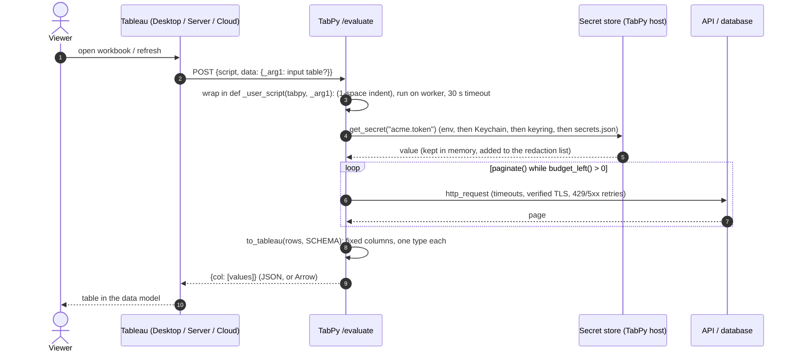
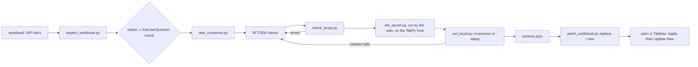

# Architecture

Two halves: **authoring-time scripts**, which run on the author's machine (from
Claude Code or by hand), and the **connector script**, which Tableau sends
to TabPy every time the workbook opens or refreshes.

## Runtime: what happens on every open/refresh



On failure, the runtime raises `RuntimeError("tabext: …")` with every
resolved secret replaced by `<redacted>` and query strings removed. TabPy
returns it as HTTP 500 `info`, and Tableau shows it.

## Authoring: what the skill does



## The connector script layout

```
# header comments: grain, secrets needed, deps, paste steps
# ---- CONFIG   (edit freely: URLs, windows, SCHEMA, budgets, CA_BUNDLE)
# ==== BEGIN TABEXT RUNTIME v3  (never edit; refresh with new_connector --refresh-runtime)
#      budget_left/check_budget, redact, remember_secret, get_secret, http_request/get/post,
#      oauth2_client_credentials, paginate, dig, items_at, input_records, to_tableau
# ==== END TABEXT RUNTIME v3
# ---- FETCH    (auth(), request_page(), get_page(), fetch(), to_row(), rows())
return to_tableau(rows(), SCHEMA)
```

The runtime is **inlined** rather than imported, because a Table Extension script
is self-contained text in the workbook. A TabPy host can't be assumed to have
any package besides what the admin installed. `check_script` compares the
block byte for byte with `runtime/tabext_runtime.py` (`TE-RUNTIME-DRIFT`),
so a hand-edit is caught and an old version can be refreshed. Only the
byte-identical canonical block is exempt from the secret scan and the other
rules; anything else between the markers is checked like user code, and
`patch_workbook` refuses a same-version hand-edited block even with `--force`.

Runtime v3 (2026-10 review) changes: the session ignores `.netrc` and env
proxies-with-credentials (`trust_env = False`; proxies come from
`requests.utils.get_environ_proxies` per URL); `verify` is `CA_BUNDLE`, else
`REQUESTS_CA_BUNDLE` / `CURL_CA_BUNDLE` if that file exists, else the
system store; any credential-named header (`X-Api-Key`, `Cookie`, …) blocks
cross-host redirects; `Retry-After` accepts an HTTP date; the budget uses a
monotonic clock; `to_tableau` turns any exception into a redacted,
query-stripped `tabext:` error; number coercion strips commas only as
thousands separators, treats epoch values ≥ 1e17 as nanoseconds and converts
integral `Decimal`s exactly.

Design constraints that come from TabPy, not from taste:

| Constraint | Consequence in the code |
|---|---|
| The script is a function body (one-space prefix per line) | top-level `return`; spaces only; no `yield`/`global`/`if __name__` |
| exec'd in the handler module's globals | runtime state lives in function locals (`_STATE`) |
| Worker thread with a hard timeout | no `signal`. Every wait is bounded by `budget_left()`, and the read timeout shrinks as the budget runs out |
| JSON via `simplejson.dumps(ignore_nan=True)`, or Arrow via `pyarrow.table` | `to_tableau` emits only `str/int/float/bool/None`, one type per column |
| `_arg1` exists only with an input table; dict or DataFrame | `_INPUT = locals().get("_arg1")`, `input_records()` |
| Script text is logged at INFO and saved in the workbook | secrets only via `get_secret()` on the host; urllib3 logging is silenced |
| `exec`'d in one shared process | every script on a TabPy can call `get_secret()` for any name the TabPy user can read, so one TabPy per trust boundary |
| Reruns on every open | small default windows; a TTL cache pattern in `connector_patterns.md` |

## Authoring scripts

| Module | Role |
|---|---|
| `tabext_common.py` | the exact TabPy wrapper (`tabpy_wrap`), credential detection (`CRED_RX`, `credential_spans`, `redact_text`), runtime-block extraction, the `Workbook` class (`.twb`/`.twbx` read, serialize with CR preservation, in-memory `.twbx` re-zip), and Table Extension discovery |
| `check_script.py` | text rules, then compile in the wrapper, then `ast.parse(feature_version)`, then AST rules (shallow walk that skips nested defs, lambdas and comprehensions for return/yield) |
| `run_local.py` | in-process: wrap, `exec` in a clean namespace, run on a thread with a timeout, then DataFrame to dict, `simplejson` and `pyarrow` round-trips, and declared vs observed types. `--tabpy`: real `/evaluate` with basic auth from secret `tabpy.password` |
| `new_connector.py` | string templates per kind/auth/pagination. Every generated combination compiles; only `TE-TODO` remains |
| `patch_workbook.py` | edits the `<script-code>` text, rebuilds `metadata-record`s and `<column>` types for the output relation, reports dropped columns used on sheets, re-validates (no credential, script round-trips) before writing |
| `keystore.py`, `set_secret.py` | the same lookup chain as `get_secret`, used for writes; hidden input; never prints values |

## Testing

`tests/test_skill.py` starts a loopback mock API (bearer auth, pages,
cursor, Link header, 429 + Retry-After, slow, HTML, echoing error) and runs
scaffolded connectors end to end: in-process, and with `--tabpy`, through a
real TabPy. It also covers the output validator, checker rules, runtime
coercion, and workbook patch round-trips (including the refusal to write a
credential).
